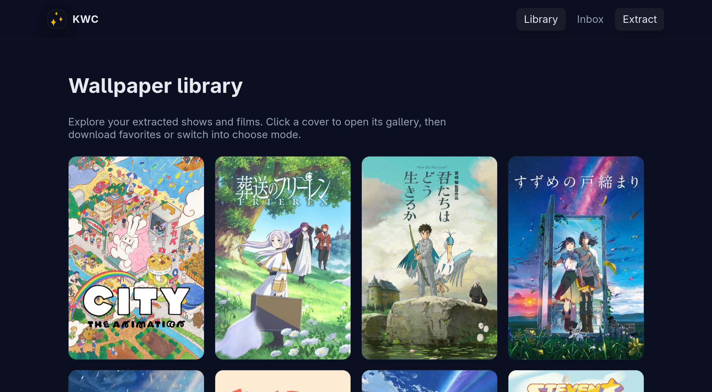
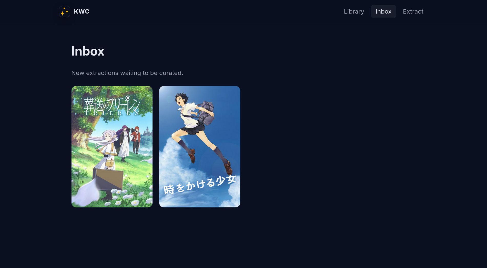
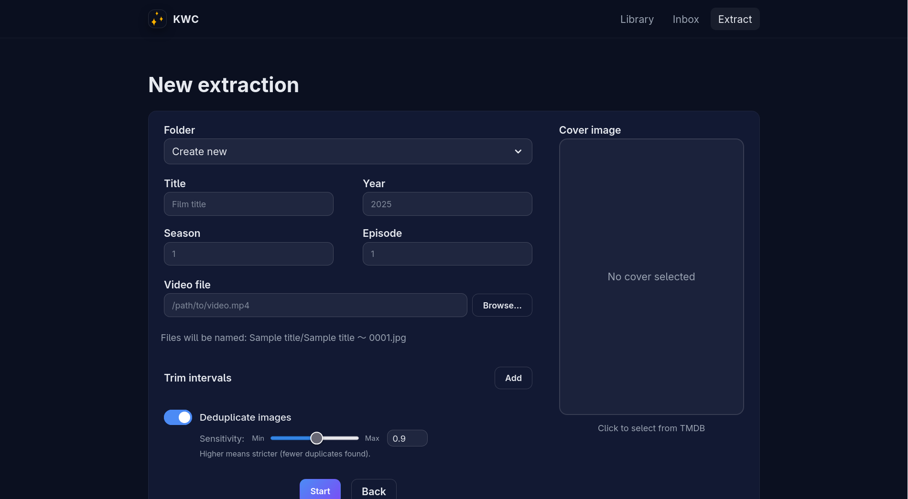
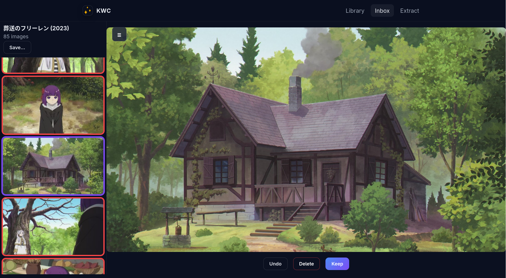
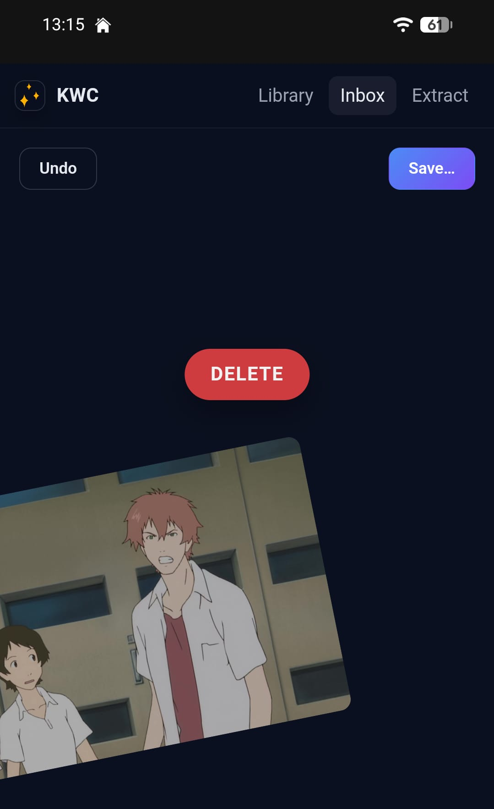

# Descripción

Herramienta web basada en Django para hacer crecer, organizar y gestionar mi colección de fondos de pantalla, que consiste principalmente en fotogramas de películas y series de animación. Es también el proyecto con el que experimento con las últimas tecnologías y herramientas de IA para aprender a utilizarlas de manera efectiva.

El proyecto tiene tres partes principales: un extractor, que al darle un archivo de video produce los mejores fotogramas (no simplemente X fotogramas por segundo); un selector, que me permite elegir las imágenes que quiero conservar en una interfaz cómoda de deslizar izquierda/derecha que puedo usar tanto en mi escritorio como en el móvil; y un gestor, que me permite ver, descargar, eliminar, etc... las imágenes de mi colección, agrupadas por película/serie (y dentro de las series, por temporada y episodio) con metadatos y en una interfaz bonita. Todo esto funciona de manera *stateless* sobre mi carpeta local de fondos de pantalla.

# Mi trabajo

He hecho y rehecho este proyecto a mano varias veces y de muchas formas: como una CLI, como una aplicación local Adwaita, y ahora, como una aplicación web en Django. Ya entiendo el espacio del problema, la forma de la aplicación final, los requisitos y los principales problemas que tiene este proyecto. Además, esta es una herramienta interna, utilizada solo por mí, y de ninguna manera crucial o necesaria, por lo que no pasa nada si se rompe.

Esto hace que sea perfecta para probar y experimentar con todas las nuevas herramientas que usan LLMs, agentes, etc. Puedo evaluarlas y ver dónde tienen éxito, dónde se quedan cortas y dónde fallan completamente, y puedo aprender cómo usarlas y sacarles el máximo provecho.

He estado utilizando principalmente GitHub Copilot, tanto en el editor VSCode, en la CLI y en la interfaz web de GitHub, ya que es a lo que tengo acceso por el momento, aunque quiero probar muchas otras herramientas y modelos. 

Con estas herramientas creo un plan para la implementación, lo ejecuto, pruebo manualmente y mediante pruebas unitarias automatizadas la función, y luego reviso las adiciones en la PR. Algunos de estos pasos son realizados completamente por un LLM y otros completamente por mí, pero la mayoría son una mezcla entre los dos.

Estaba especialmente interesado en la parte de extracción, ya que el resto de la aplicación es básicamente una interfaz sobre una carpeta y mecanismos básicos de mover/renombrar/eliminar. En las primeras iteraciones de este proyecto desarrollé un algoritmo personalizado desde cero para poder analizar el archivo de video y extraer los fotogramas. No solo X fotogramas por segundo, lo cual produce una cantidad inmanejable de imágenes (la mayoría duplicadas), sino una detección realmente inteligente de cuándo cambia el video y qué imágenes son "mejores" (bien enfocadas, estáticas, fotogramas clave en lugar de intermedios...). Esto lo hice mediante el uso de herramientas matemáticas como *perceptual hashing*, análisis de color y detección de desenfoque sobre una ventana deslizante para detectar localmente el fotograma más "estable". Sin embargo, este enfoque no era eficiente y era difícil de paralelizar, principalmente debido al cuello de botella de lectura del archivo de video para analizar todos los fotogramas antes siquiera de extraerlos.

Las iteraciones posteriores hacen uso de `ffmpeg` para producir estos fotogramas clave directamente desde la codificación del archivo de video, que ya empaqueta una aproximación de esta información. Dado que un video se codifica utilizando fotogramas clave como anclas y diferencias desde los fotogramas clave para almacenar los intermedios, al utilizar los fotogramas clave de la codificación puedo obtener un conjunto de imágenes que normalmente están muy cerca de los fotogramas clave reales de la animación. Además, este proceso es altamente paralelizable porque no se realiza ningún análisis, solo extracción del archivo de video.

También añadí un paso de deduplicación opcional y configurable para reducir aún más el número de fotogramas a seleccionar a una cantidad manejable.

# Lo que aprendí

- A procesar un archivo de video utilizando herramientas como *perceptual hashing*, análisis de color y detección de desenfoque para extraer sus fotogramas clave
- Cómo se codifica un archivo de video, qué información contiene la codificación y cómo extraer fotogramas clave de manera eficiente utilizando esa información
- Cómo usar diferentes herramientas de IA, qué pueden y qué no pueden hacer, y cómo sacarles el máximo partido en diferentes contextos y para diferentes tareas

# Galería

