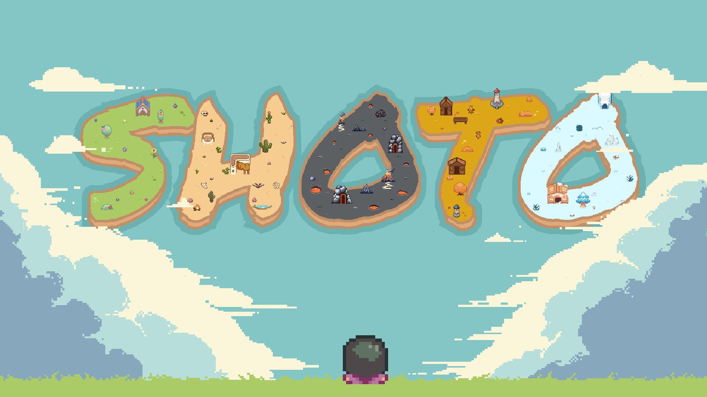
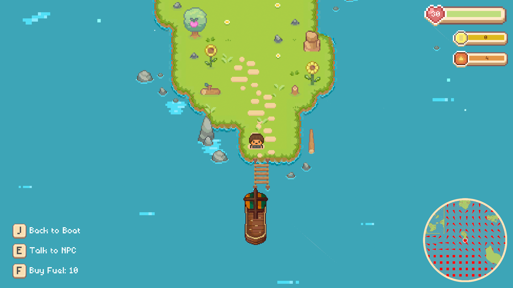
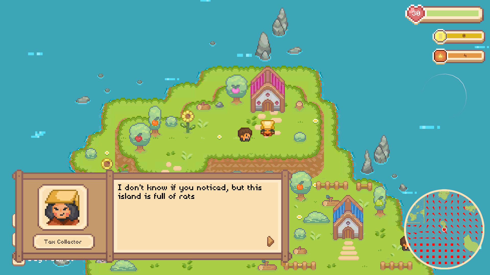
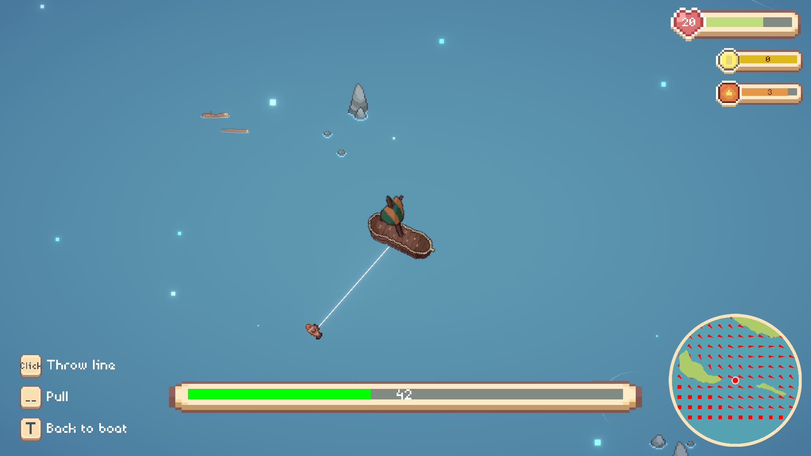
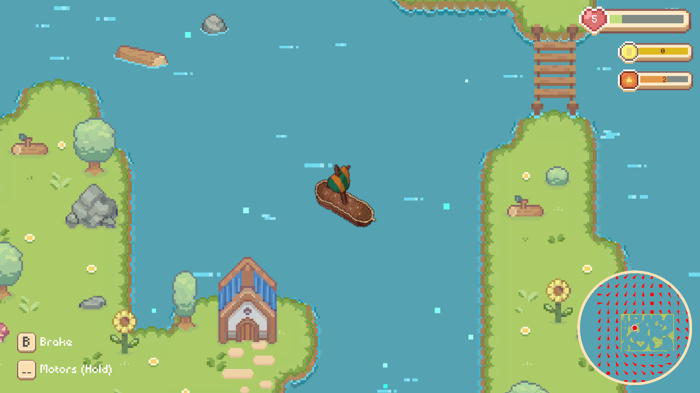

# Descripción

Pequeño juego realizado como trabajo final en grupo para la asignatura de Diseño y Programación de Videojuegos en el Politecnico di Milano. Es una aventura atmosférica de navegación en velero que invita a explorar un extenso archipiélago a bordo de una embarcación personalizable. Mezclando navegación basada en física con mecánicas de gestión de recursos, el juego reta a los jugadores a dominar las corrientes de viento y las mareas para viajar entre islas. La experiencia se centra en un bucle relajante pero entretenido: cruzar el océano, descubrir nuevos pueblos y completar una colección de peces para intercambiarlos por mejoras para el barco.

# Mi trabajo

Fui el responsable del grupo, ya que la idea original era mía, y mi papel principal fue organizar el desarrollo del proyecto, asegurarme de que hacíamos lo que queríamos y a tiempo, y gestionar la comunicación entre los miembros del equipo, que incluían tanto programadores como artistas.

Programé varias partes del juego, incluyendo todo el sistema de diálogos, parte del sistema de misiones e inventario, parte del sistema de navegación y parte del sistema de pesca.

También trabajé como escritor del juego, diseñando la historia (poca, pero la hay), los diálogos de todos los personajes y el diseño del mapa.

# Lo que aprendí

- Unity, cómo funciona y cómo hacer que haga lo que quieres
- Cómo gestionar un equipo con personas de diferentes perfiles y con ideas distintas sobre cómo debe ser el juego

# Galería

